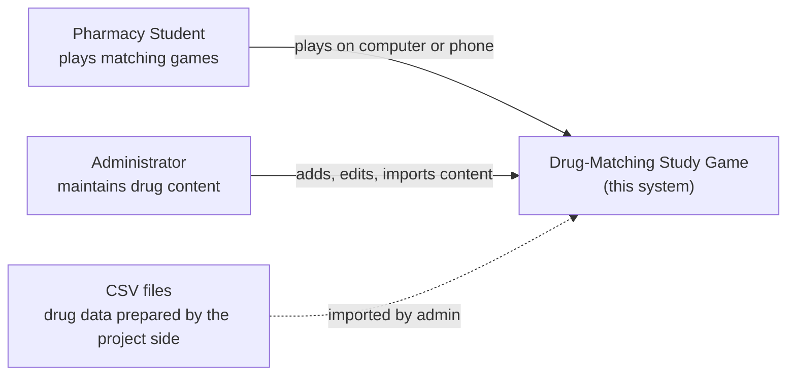
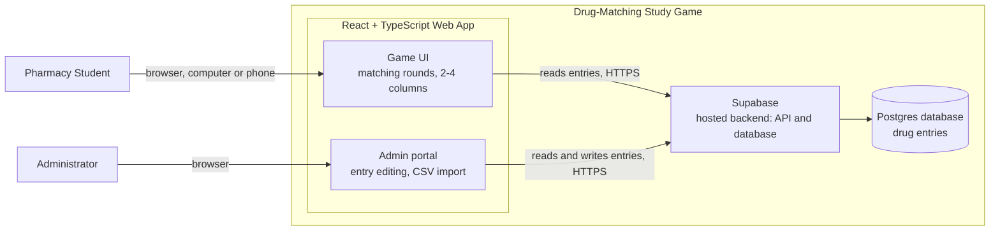
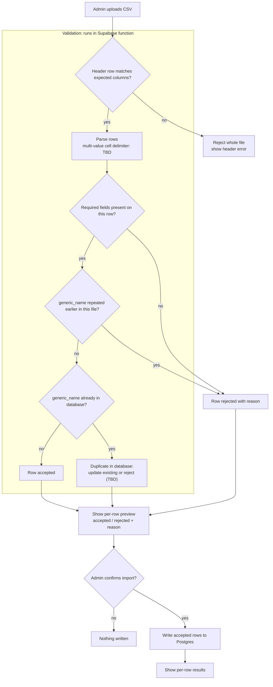
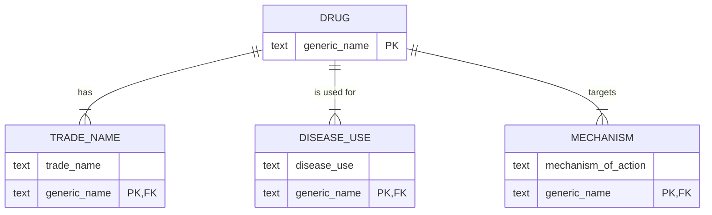

# Design

## 1. Overview

The Customizable Drug-Matching Study Game is a game-based study app for PharmD students preparing for their final licensing exam. It is built with a React front end, TypeScript, and Supabase for backend data.

Intended users:

- **Pharmacy students** play the game, on both computers and phones.
- **Administrators** or our project partner, who adds and edits drug content, including by bulk CSV import.

Technologies decided so far:

- **React** for the front end
- **TypeScript** for application code
- **Supabase** for backend data
- **Vercel** for primary frontend hosting
- **Cloudflare** as a backup hosting option

Functional and non-functional requirements are in [docs/requirements.md](requirements.md)].

### Key assumption: anonymous and stateless

The design rests most heavily on one assumption: the game is anonymous and stateless. There are no student accounts, profiles, scores, or progress tracking, and no student data is collected. The only persisted data is the public drug content supplied by the project partner. We confirmed this with the partner.

This assumption drives several decisions: no privacy review is needed, the access model is simple (anonymous reads, writes only by one administrator), game logic can safely run in the client, and no custom backend is needed.

If the scope ever changes (for example, progress tracking, spaced repetition, or per-user missed-drug lists), we will treat it as a new design decision rather than an incremental addition. It would require authentication, per-user access rules, a larger data model, and a privacy review.

### Game play

Each round shows 2–4 columns. Each column holds one field of the drug entries in that round (generic name, trade name, mechanism of action, disease use). The player matches the items across columns that belong to the same drug. The number of columns (2, 3, or 4) sets how many fields are matched at once. Rounds are built at runtime by sampling drug entries. The "simpler" and "more complex" modes: [TBD, define here or in [docs/requirements.md](requirements.md)].

## 2. Architecture

### Context diagram (C4 level 1)

### Container diagram (C4 level 2)

Notes on the diagram:

- Supabase provides the database and a generated API, so no separate custom backend server needed. Game logic (building a round, checking matches) runs in the React app. If some logic must run server-side (validating a large CSV import), it would be added as a Supabase function or database rule.
-  The team has created an initial Supabase project and added group members with Admin/Owner access. Database tables, application integration, and access policies are still in development.
- Vercel has been selected as the primary frontend hosting platform, with Cloudflare as a backup option.
- The admin portal is a protected section of the existing React and TypeScript web app. It is separate from the student-facing game and reachable only after the administrator signs in. It lets the project partner add, edit, and delete drug entries manually and import them in bulk from CSV.
- **Why a custom admin portal instead of Supabase's built-in CSV upload:** our data model uses separate tables linked by foreign keys, so terms can be related to each other. Supabase's upload tool loads one file into one table and cannot tell which columns belong in which table. The portal splits the uploaded CSV's columns into separate datasets, one per table, and writes each to the correct table with the correct relationships.
- **Validation before saving:** the portal runs validation scripts on the uploaded file before anything is sent to Supabase. Problems are reported by row and column (for example, "row 14, mechanism_of_action: empty"). Nothing is written until the file passes validation and the partner confirms the import.
- **Single-transaction write:** one upload touches several linked tables, so the portal sends the validated data to a Supabase function that inserts everything in one database transaction. If any insert fails, the whole import is rolled back, so a failure cannot leave partial or orphaned rows.
- Phone support is through the browser, so the UI must be responsive. Possibly need to be installable as a PWA is [TBD].

 
Decisions this diagram depends on: where validation runs, how duplicates are handled, and the multi-value delimiter.

### Architecture components

| Component | Responsibility | Status |
|---|---|---|
| React + TypeScript web app: game | Interface students use to play matching games; supports 2–4 column matching and simpler/more complex modes; usable on desktop and phone screens | [planned] |
| React + TypeScript web app: admin portal | Lets the administrator sign in, add, edit, and delete drug entries, and import them from CSV; validates files before saving and splits columns into per-table datasets; connected to Supabase| [planned] |
| Supabase (API) | Receives reads and writes from the web app and enforces access rules (public reads, administrator-only writes); runs the transactional import function | [in progress]: project created and team added; application integration and access policies not yet done |
| Postgres database (inside Supabase) | Stores the drug entries the game uses | [in progress]: hosted with the Supabase project; tables not yet created |

- If Supabase fails then there would be no content to fill out the drug data and would be left blank giving no options to choose from for matching
## 3. Interfaces and Contracts

### Web app ↔ Supabase

The web app talks to Supabase through the Supabase JavaScript/TypeScript client library over HTTPS. The game reads drug entries; the admin portal is able to read and writes them. 

### Access control [proposed, not yet implemented]

Students are anonymous: they do not log in and can only read drug entries.

The only login is a single administrator account for the project partner. The team creates it through Supabase Auth, and public sign-ups are disabled so no one else can register. Administration happens in an admin portal built into the game website. The portal is separate from the student-facing game and reachable only after signing in.

Supabase access policies (row-level security) allow reads for everyone and allow writes, including CSV import, only for the authenticated administrator account. Only the administrator can add, edit, or delete drug entries, so the data stays protected.

### CSV import format

The partner supplies a normal CSV with one row per drug and one column per field. The admin portal splits these columns into separate datasets, one per database table, so each is written to its table with the correct relationships (see Section 4).

| Column | Required | Notes |
|---|---|---|
| generic_name | yes | unique primary key candidate; The more medical name |
| trade_name | yes | The "brand" name or more common name |
| disease_use | yes | What the drug is used to commonly treat |
| mechanism_of_action | yes | How or what the drug targets for treament |

**Format rules**

- The first row is a header row with exactly the column names above.
- The file is encoded as UTF-8.
- Cells with more than one value separate them with a pipe character (`|`), for example `Tylenol|Panadol`. The portal splits these cells to create the rows in the trade name, disease use, and mechanism tables.
- Duplicate rule: `generic_name` must be unique within the file and must not already exist in the database. Comparison ignores capitalization and surrounding spaces. A file with duplicates is rejected.
- Empty required cells are rejected.

**Where the rules come from.** We already have a sample of the partner's data, so the column rules and the multi-value convention are derived from it, and the sample is also used as a test case for the validator.

**Partner support.** We give the partner a clean example CSV and a short format sheet. The sheet explains how to save from Excel as "CSV UTF-8" so special characters survive.

**Error reporting.** The portal reports problems by row and column (for example, "row 14, mechanism_of_action: empty"). Nothing is saved until the whole file passes and the partner confirms the import.

### TypeScript

The project uses TypeScript for application code. Shared interfaces and types should be used where components exchange structured data, in particular a `DrugEntry` type that matches the database row and the CSV columns. If the team generates types from the Supabase database, record the command here once it exists.

## 4. Data Model

The DRUG table stores each drug's generic name as its primary key, which uniquely identifies each drug. The generic_name field is also used as a foreign key in the TRADE_NAME, DISEASE_USE, and MECHANISM tables to connect their entries to the corresponding drug.

The related tables use composite primary keys consisting of generic_name and their respective information fields. This allows the same trade name, disease use, or mechanism of action to appear under different drugs while preventing duplicate entries for the same drug.

Drugs are not grouped into categories or decks. Each drug is a single entry with its corresponding fields: generic name, trade name, diseases treated, and receptor targeted. Every round is built by sampling from the full set of entries. If the partner later wants grouping (for example, by drug class or exam topic), we will treat it as a new design decision. The medical content comes from the project side, provided by the partner, so the team has to build the structure of the data, not its medical correctness.

Privacy: no student data is collected. The game is anonymous (see "Key assumption" in §1), and the only stored data is public drug content provided by the project partner. The single administrator login holds no student information. If accounts or progress tracking are ever added, this section must be revisited for authentication, data retention, and institutional privacy concerns (such as FERPA-type requirements).

## 5. Deployment
- Front end hosting: Vercel.
  Data: a hosted Supabase.
- Production: Team Lead will have ownership of both accounts; Project partner agreed to target a working model in Spring 2027.
- Check before launch: Supabase plan limits, who owns the Supabase project after the team's term ends (ADR-002, to be written). Deployment for mobile compatibility. CSV import works with partner access.
- Rollback: redeploy the previous front-end build. Try it once and record that it
  works.

## 6. Deferred Decisions

- Game modes or features beyond the initial matching game. After first working version.
- Student accounts, progress tracking, or score persistence: not planned. The design assumes an anonymous, stateless game (see "Key assumption" in §1), so adding any of these would be a new design decision.
- Performance or database optimization, until real content volume and usages are known.
- Installable (PWA) or offline use, until we know the process of deployment on mobile.

## 7. Open Technical Questions

- **Duplicates already in the database:** the current design rejects the file. Confirm with the partner whether they would rather update existing drugs when they re-upload.
- **Multi-value delimiter:** confirm the pipe character (`|`) against the partner's sample file.
- **Repo and hosting access:** how will content and code reach GitHub, through the hosting platform or a repo token? (Your original fourth question was about this; keep it only if it is still unresolved.)

## 8. Development Workflow

### Linting [implemented]

Linting for TypeScript and React runs in CI automatically on a pull request and flags issues. The configuration is stored in the root directory in `package.json` and `eslint.config.mjs`. The team tested the configuration using files with known errors: the linter correctly identified files containing errors and passed after those errors were corrected.

Commands:

- `npm run lint`: Checks for linting problems.
- `npm run lint:fix`: Attempts to automatically fix supported linting problems.

### Testing [partially implemented]

Vitest coverage tooling is being incorporated into the project to support automated testing and code coverage. It has been implemented with limited capacity.
