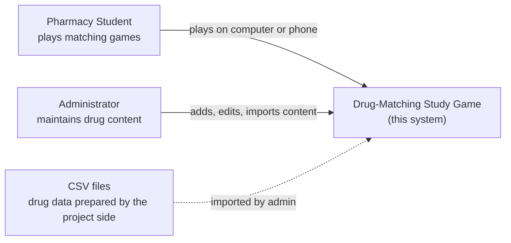
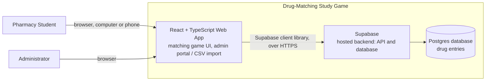
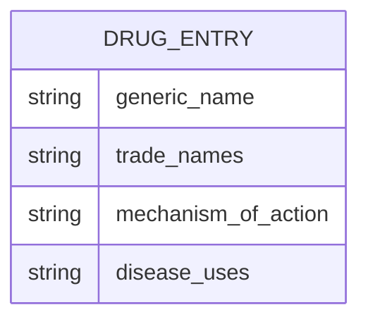

# Design

## 1. Overview

The Customizable Drug-Matching Study Game is a game-based study app for PharmD students preparing for their final licensing exam: Decided so far: a React front end, and TypeScript, with a Supabase for backend data.

Intended users:

- **Pharmacy students** play the game, on both computers and phones.
- **Administrators** Project partner add and edit drug content, including by bulk CSV import.

Technologies decided so far:

- **React** for the front end
- **TypeScript** for application code
- **Supabase** for backend data

Functional and non-functional requirements in `docs/requirements.md`. 

## 2. Architecture

### Context diagram (C4 level 1)

### Container diagram (C4 level 2)

Notes on the diagram:

- Supabase provides the database and a generated API, so no separate custom backend server needed. Game logic (building a round, checking matches) runs in the React app. If some logic must run server-side (validating a large CSV import), it would be added as a Supabase function or database rule.
- Admin portal is yet to be decided on the function [TBD].
- Phone support is through the browser, so the UI must be responsive. Possibly need to be installable as a PWA is [TBD].

### Architecture components

| Component | Responsibility | Status |
|---|---|---|
| React + TypeScript web app: game | Interface students use to play matching games; supports 2–4 column matching and simpler/more complex modes; usable on desktop and phone screens | [planned] |
| React + TypeScript web app: admin portal | Lets non-technical users add, edit, and remove drug entries and import them from CSV; connected to Supabase| [planned] |
| Supabase (API) | Receives reads and writes from the web app and enforces access rules, allows for CSV | [planned] |
| Postgres database (inside Supabase) | Stores the drug entries the game uses | [planned] |

- If Supabase fails then there would be no content to fill out the drug data and would be left blank giving no options to choose from for matching
## 3. Interfaces and Contracts

### Web app ↔ Supabase

The web app talks to Supabase through the Supabase JavaScript/TypeScript client library over HTTPS. The game reads drug entries; the admin portal is able to read and writes them. 

### CSV import format [TBD]

Proposed starting point for the team:

| Column | Required | Notes |
|---|---|---|
| generic_name | yes | unique key candidate |
| trade_name | yes | a drug may have more than one; representation |
| mechanism_of_action | yes | free text |
| disease_use | yes | free text; a drug may have more than one use |

Open points: header row with column names, probably use the standard encoding (UTF-8), how multiple trade names or will be handled in one cell, and what happens with duplicate names. The admin portal shows a result of import with per-row results (accepted, or rejected with a reason).

### TypeScript

The project uses TypeScript for application code. Shared interfaces and types should be used where components exchange structured data, in particular a `DrugEntry` type that matches the database row and the CSV columns. If the team generates types from the Supabase schema, record the command here once it exists.

### Linting

Linting for TypeScript and React; runs in CI automatically on a pull request and flag issues and auto lints if plausible with: **npm run lint:fix**. Only .md files are checked by linter. Stored in root as `package.json` and `eslint.config.mjs`. Can run with: **npm run lint**.

## 4. Data Model

The core entity is a **drug entry**. Fields the project has already described:

- Generic name
- Trade name(s)
- Mechanism of action
- Disease use(s)

This is a working sketch, not a finalized schema. Supabase uses Postgres, so the entity will become one or more tables, but table and column names, types, and constraints are [TBD].

Persisted: drug entries, maintained by admins. Derived at runtime: each game round, built by sampling entries and arranging them into 2–4 matching columns.

[TBD] : whether trade names and uses are separate tables or fields on one table, whether drugs are grouped into categories or decks, and whether game sessions, scores, or student accounts are stored at all. The medical content comes from the project side, provided by the partner so the team has to build the structure of the data, not its medical correctness.

Privacy: the drug content is not student data. And don't have any sort of data collecting. All information and data is public knowledge provided by the project partner. If accounts or progress tracking are added, then we will revisit this section for privacy implications.

## 5. Deployment
- Front end hosting [TBD]: Cloud Flare or GitHub Pages.
  Data: a hosted Supabase.
- Production: Team Lead will have ownership of both accounts; Project partner agreed to target a working model in Spring 2027.
- Check before launch: Supabase plan limits, who owns the Supabase project after the team's term ends (ADR-002, to be written). Deployment for mobile compatibility. CSV import works with partner access.
- Rollback: redeploy the previous front-end build. Try it once and record that it
  works.

## 6. Deferred Decisions

- Game modes or features beyond the initial matching game. After first working version.
- Student accounts, progress tracking, or score persistence, until the team determines the scope of the project.
- Performance or database optimization, until real content volume and usages are known.
- Installable (PWA) or offline use, until we know the process of deployment on mobile.

## 7. Open Technical Questions

- **Admin portal:** same React app or separate? How is CSV parsing and validation done in the browser or server-side?
- **CSV rules:** Formatting for the CSV: header format, multi-value cells, and duplicate handling.
- **Importing:** How will we handel the ability to import drug info for the partner?
- **Hosting platform:** What will be our front-end hosting platform and what is the cost and compatability
